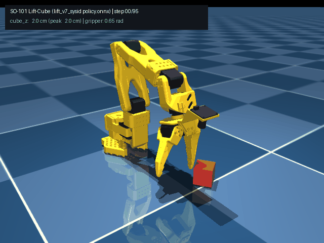
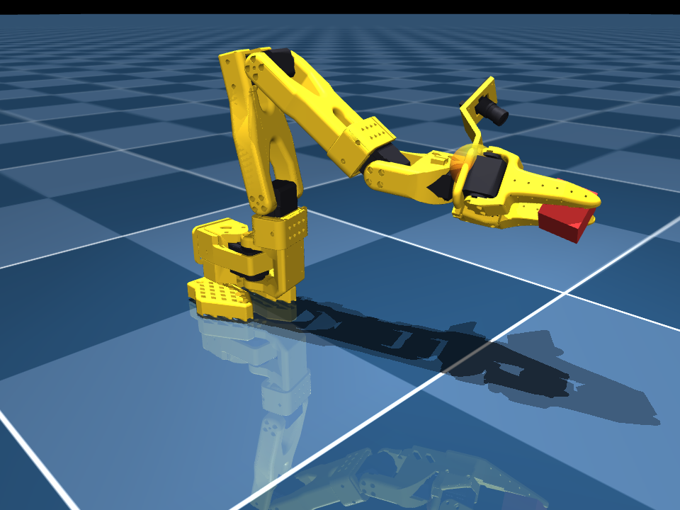

# so101-mjlab

Manipulation environments, GPU reinforcement learning training, and 50 Hz sim-to-real deployment for the open-source 6-DoF **SO-ARM101** robot arm built on [`mjlab`](https://github.com/mujocolab/mjlab).

<p align="center">
  
  
</p>

## Registered Tasks

Installing `so101-mjlab` registers three manipulation tasks via the `mjlab.tasks` entry point:

| Task ID | Observation Space | Description |
| :--- | :--- | :--- |
| `Mjlab-Lift-Cube-SO101` | 24-D state | Reach, grasp, and lift a 3 cm cube to randomized 3D targets using the SO-101 rotary jaw gripper. |
| `Mjlab-Lift-Cube-SO101-Rgb` | State + 32x32 RGB (`wrist_cam`) | Visual cube lifting with domain-randomized cube colors and Spatial Softmax CNN policy. |
| `Mjlab-Lift-Cube-SO101-Depth` | State + 32x32 Depth (`wrist_cam`) | Depth-based visual cube lifting from the wrist-mounted camera. |

## Quick Start

### 1. Preview the SO-101 Robot in MuJoCo

```bash
uv run python -m so101_mjlab.so101.so101_constants
```

### 2. Interactive Play & Evaluation

Evaluate with a zero policy in the `mjlab` viewer:

```bash
uv run play Mjlab-Lift-Cube-SO101 --agent zero
```

Evaluate a trained checkpoint:

```bash
uv run play Mjlab-Lift-Cube-SO101 --checkpoint-file checkpoints/latest_model.pt
```

### 3. Training (Local CUDA GPU or Automated Remote Google Colab GPU)

Train on a remote Google Colab GPU from the terminal (uploads a repo snapshot, runs `mjlab` PPO training, exports `policy.onnx`, and downloads the artifacts into `checkpoints/<run_name>/`):

```bash
./scripts/train.sh lift_v4 --colab --env.scene.num-envs 4096 --agent.max-iterations 1000
```

Or train directly on a local CUDA workstation:

```bash
uv run train Mjlab-Lift-Cube-SO101 --env.scene.num-envs 4096 --agent.max-iterations 1000
```

An interactive Colab notebook is also included at [`notebooks/train_so101_colab.ipynb`](notebooks/train_so101_colab.ipynb).

### 4. Physical SO-101 Hardware Deployment (macOS / Linux)

Deploy the exported [`checkpoints/policy.onnx`](checkpoints/policy.onnx) policy at 50 Hz over 1 Mbps Feetech STS3215 USB serial:

```bash
# Dry-run physics and ONNX verification without hardware plugged in
uv run so101-deploy --dry-run --onnx checkpoints/policy.onnx

# Live deployment on physical SO-101 follower arm
uv run so101-deploy --onnx checkpoints/policy.onnx --port /dev/tty.usbmodem5B790143431
```
