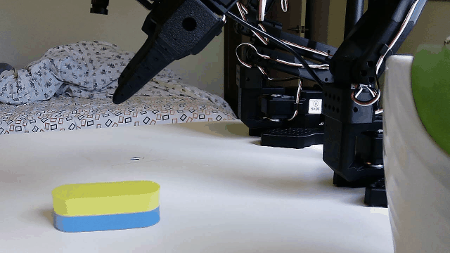
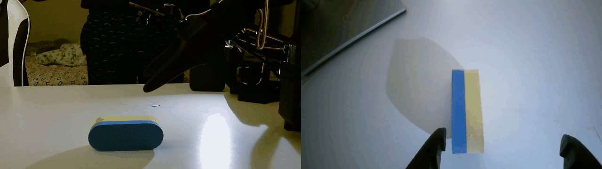

# so101-mjlab

**so101-mjlab** trains and deploys a `50 Hz` reinforcement learning policy for the open-source 6-DoF **SO-ARM101** robot arm (`5` arm joints + `1` rotary jaw gripper) built on [`mjlab`](https://github.com/mujocolab/mjlab).

<p align="center">
  
  
</p>
<p align="center">
  
</p>

***

## 1. Registered Tasks

Installing `so101-mjlab` registers 3 manipulation tasks via the `mjlab.tasks` entry point:

| Task ID | Observation | Description |
| :--- | :--- | :--- |
| **`Mjlab-Lift-Cube-SO101`** | `24D` state | Reach, grasp, and lift `2.8 to 4.55 cm` objects to randomized 3D targets (`checkpoints/policy.onnx`). |
| **`Mjlab-Lift-Cube-SO101-Rgb`** | State + `32x32` RGB (`wrist_cam`) | Visual lifting with domain-randomized object colors. |
| **`Mjlab-Lift-Cube-SO101-Depth`** | State + `32x32` Depth (`wrist_cam`) | Depth-based lifting from the wrist camera. |

***

## 2. Sim-to-Real Setup

| Component | Details |
| :--- | :--- |
| **Actuator SysID** | Feetech STS3215 (`12V`) fitted from `50 Hz` step responses ([`sysid_sts3215.json`](checkpoints/sysid_sts3215.json)): `kp = 18.33`, `kd = 1.34`, `frictionloss = 0.20`, `armature = 0.0211`, effort limits `1.47 N*m` (arm) / `1.20 N*m` (gripper) |
| **RL Training** | `2048` parallel MuJoCo envs, `1000` PPO iterations (`49.15M` steps) with object size, mass, friction, PD gain, effort limit, and `0 to 2` step delay randomization |
| **50 Hz Real Loop** | [`deploy_real.py`](src/so101_mjlab/deploy_real.py) reads the 6 STS3215 encoders (`q_cur`), runs [`policy.onnx`](checkpoints/policy.onnx), and writes the 6 joint position targets over `1 Mbps` USB serial |
| **Object Pose Input** | Initial 3D object position is passed via `--cube-xyz` in the base frame; once the jaws stall on the object, the object position tracks the jaw pad midpoint (`pad_mid`) |

***

## 3. Quickstart Commands

```bash
# 1. Preview robot and evaluate in MuJoCo
uv run python -m so101_mjlab.so101.so101_constants
uv run play Mjlab-Lift-Cube-SO101 --agent zero
uv run so101-deploy --dry-run --onnx checkpoints/policy.onnx

# 2. Train policy (remote Google Colab GPU or local CUDA GPU)
./scripts/train.sh lift_v7_sysid --colab --env.scene.num-envs 2048 --agent.max-iterations 1000
uv run train Mjlab-Lift-Cube-SO101 --env.scene.num-envs 2048 --agent.max-iterations 1000

# 3. Deploy ONNX policy to physical SO-ARM101 at 50 Hz
uv run so101-deploy --onnx checkpoints/policy.onnx --port /dev/tty.usbmodem5B790143431 --cube-xyz 0.215 0.002 -0.036

# 4. Run 50 Hz servo system identification or unit tests
uv run python scripts/sysid_sts3215.py --port /dev/tty.usbmodem5B790143431
uv run pytest
```

***

## 4. License

Licensed under [Apache 2.0](LICENSE). SO-ARM101 meshes and base MJCF kinematics in [`src/so101_mjlab/so101/xmls/`](src/so101_mjlab/so101/xmls/) are adapted from [`TheRobotStudio/SO-ARM100`](https://github.com/TheRobotStudio/SO-ARM100).
